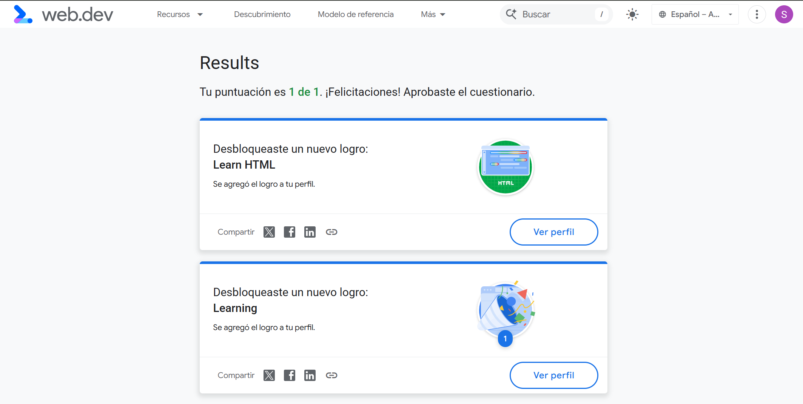

# Portafolio Web Estático

## Certificación

## Arquitectura y Decisiones Semánticas
- **Estructura Lógica:** Uso de `<header>`, `<main>`, `<section>`, `<article>` y `<footer>` para construir un árbol DOM navegable.
- **Accesibilidad (AOM):** Implementación de nombres accesibles (`aria-label`), textos alternativos en multimedia y navegación por teclado nativa.
- **Formularios e Interactividad:** Validación nativa en el navegador mediante restricciones HTML5 (`type`, `required`).
- **Componentes Avanzados:** Uso de la API nativa `<dialog>` para modales y Web Components con Shadow DOM para garantizar encapsulamiento de estilos.